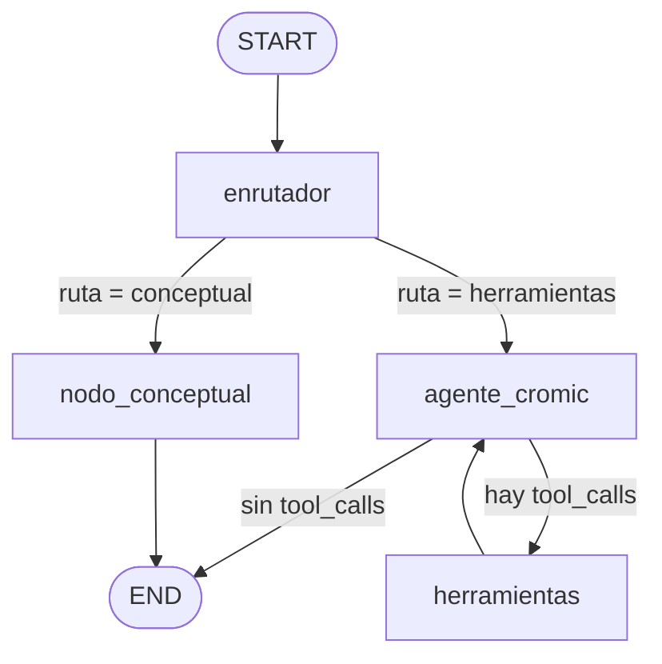

# Arquitectura de Cromic v4

Cromic v4 es un grafo de **LangGraph** con cuatro nodos. Un nodo enrutador
clasifica cada mensaje. Las consultas conceptuales se responden directamente;
las demás pasan a un agente ReAct que repite el ciclo *modelo → tools →
modelo* hasta tener la respuesta.

## Diagrama del grafo



La app también muestra este diagrama, generado en vivo con
`get_graph().draw_mermaid()`, en la barra lateral (*🕸️ Diagrama del grafo*).

## Estado compartido (`graph/state.py`)

```python
class CromicState(TypedDict):
    messages: Annotated[list[BaseMessage], add_messages]  # historial (se acumula)
    usuario: UsuarioInfo          # nombre, color_ojos, color_piel
    ruta: str                     # "conceptual" | "herramientas"
    motivo: str                   # justificación del enrutador
    herramientas_usadas: list[str]
    pasos_ejecutados: list[str]   # traza de nodos del turno
```

`messages` usa el reducer `add_messages`, así que cada nodo **agrega**
mensajes en lugar de reemplazarlos. Los campos de traza (`ruta`, `motivo`,
`herramientas_usadas`, `pasos_ejecutados`) se reinician al empezar cada turno
en `core/session.py`.

## Nodos (`graph/nodes.py`)

| Nodo | Modelo | Temperatura | Qué hace |
|---|---|---|---|
| `enrutador` | Gemini + `with_structured_output(RutaConsulta)` | 0 | Clasifica el **último** mensaje como `conceptual` o `herramientas` y da un motivo |
| `nodo_conceptual` | Gemini | 0.3 | Responde teoría de moda o color sin tools, con todo el historial |
| `agente_cromic` | Gemini + `bind_tools(TOOLS_CROMIC)` | 0.1 | Razona con el perfil del usuario y decide si llama tools |
| `herramientas` | `ToolNode(TOOLS_CROMIC)` | — | Ejecuta las tools pedidas y registra sus nombres en `herramientas_usadas` |

Los modelos se crean **una vez**, al importar el módulo, y se reutilizan en
cada turno.

### Aristas condicionales (`graph/workflow.py`)

- `_decidir_ruta`: si `ruta == "conceptual"` va a `nodo_conceptual`; en
  cualquier otro caso va a `agente_cromic`.
- `_evaluar_tools`: si el último mensaje del agente trae `tool_calls` va a
  `herramientas`; si no, va a `END`.
- `herramientas → agente_cromic` cierra el ciclo ReAct.

`recursion_limit = 15` (en `core/session.py`) limita el número de pasos por
turno para que el ciclo no sea infinito.

## Prompts (`prompts/`)

| Constante | Usada por | Contenido |
|---|---|---|
| `ROUTER_SYSTEM_PROMPT` | `enrutador` | Criterios para elegir entre conceptual y herramientas |
| `GENERAL_SYSTEM_PROMPT` | `nodo_conceptual` | Asesor general; no inventa datos del usuario |
| `AGENT_SYSTEM_TEMPLATE` | `agente_cromic` | Base + `COLORIMETRIA_REGLAS` + reglas sobre paletas y RAG. Se rellena con `.format(nombre, color_ojos, color_piel)` |
| `OUTFIT_SYSTEM_PROMPT` | `chains/outfit_chain.py` | Estilista que arma un outfit solo con prendas existentes |
| `COLORIMETRIA_REDACCION_PROMPT` | sin uso actual | Plantilla de redacción de recomendaciones |

> `AGENT_SYSTEM_TEMPLATE` usa `.format()`, así que los textos que se le
> añadan **no deben contener llaves `{}`** o el formateo fallará.

Reglas clave del agente:

- No inventar prendas, eventos ni colores; usar solo lo que devuelven las tools.
- Antes de diagnosticar la estación necesita ojos, cabello y piel. Si falta
  alguno, lo pregunta.
- Después de `diagnosticar_estacion` **siempre** llama a
  `consultar_paleta_estacional`.
- Al usar la guía (RAG), cita la sección: *"Fuente: guía de Cromic, sección …"*.

## Ciclo de un turno

1. **`app.py`**: el usuario escribe un mensaje o pulsa una sugerencia.
2. **`core/state.actualizar_perfil_usuario`**: unas expresiones regulares
   extraen el nombre (`soy…` / `me llamo…`), el color de ojos y el de piel, y
   actualizan el perfil.
3. **`core/session.responder`**:
   - crea un `MetricasCallback`;
   - invoca el grafo con `thread_id`, `recursion_limit=15` y el callback;
   - el estado de entrada incluye el nuevo `HumanMessage`, el perfil y la
     traza vacía.
4. Recorre el grafo (enrutador → conceptual | agente ⇄ herramientas).
5. `session.responder` devuelve la respuesta, la ruta, el motivo, las tools,
   los pasos, las métricas y la estación consultada (si la hubo).
6. **`app.py`** guarda el mensaje y, si se consultó una paleta estacional,
   dibuja las muestras de color bajo la respuesta.

## Memoria

- **Memoria del grafo:** `MemorySaver` guarda el estado por `thread_id`. El
  grafo se compila una sola vez con `@st.cache_resource`, así que la memoria
  dura mientras corre el proceso de Streamlit. **Se pierde al reiniciar el
  servidor.**
- **Nueva conversación:** se genera un `thread_id` nuevo (`uuid4`) y se
  limpia el estado de Streamlit.
- **Perfil:** vive en `st.session_state.perfil`. El perfil por regex solo
  guarda una palabra por rasgo; para el diagnóstico, el agente usa los rasgos
  detallados del mensaje.

## Observabilidad (`core/metrics.py`)

`MetricasCallback` es un `BaseCallbackHandler` que, en cada turno, acumula:

| Métrica | Fuente |
|---|---|
| `tiempo_total_s` | desde que se crea el callback hasta `resumen()` |
| `llamadas_modelo` | `on_chat_model_start` |
| `tokens_entrada` / `tokens_salida` / `tokens_total` | `usage_metadata` en `on_llm_end` |
| `tools` | `on_tool_start` |
| `tiempos_nodos` | `on_chain_start`/`on_chain_end`, solo para los 4 nodos del grafo |
| `errores` | `on_llm_error`, `on_tool_error` y excepciones del grafo |

Las métricas se muestran en la barra lateral (*📊 Último turno* y totales de
la sesión) y se añaden como una línea JSON a `logs/metricas.jsonl`. Si falla
la escritura del log, se ignora sin interrumpir la app.

## Manejo de errores en la interfaz

`app.py` traduce los errores de la API a mensajes legibles:

| Error detectado | Mensaje |
|---|---|
| `RESOURCE_EXHAUSTED` / `429` | Límite de uso gratuito alcanzado |
| `NOT_FOUND` / `404` | Modelo no disponible; revisar `GEMINI_MODEL` |
| `API key` / `403` | API key no válida |
| otro | Texto del error, recortado a 200 caracteres |
